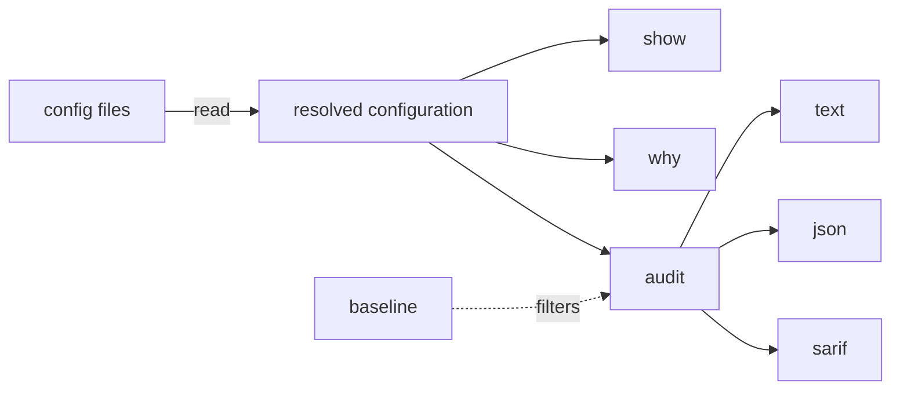

<div align="center">

# harness-blast-radius

**Reports what a coding agent's configuration lets it do without asking, and the file that allows it.**

Rust 1.85+ · Linux and macOS · MIT license · supports Claude Code; Codex and Cursor not yet; plugin contents are not read

[](https://github.com/cdvel/harness-blast-radius/actions/workflows/ci.yml) [](https://github.com/cdvel/harness-blast-radius/releases/latest)

[Uses](#uses) · [Install](#install) · [Commands](#commands) · [Tests](#tests) · [Architecture](docs/ARCHITECTURE.md) · [Rules](docs/rules.md)

</div>


You clone a repository, open Claude Code, and it asks whether you trust the folder. If you say yes, the repository's settings take effect. A hook in them can run a downloaded script every time a session starts. An allow rule such as `Bash(python3 *)` lets Python read the `.env` file the same settings deny to Claude Code's file tools. No single settings file tells you this, because rules merge across files and some only apply after you trust the folder.

`harness-blast-radius` reads every file Claude Code reads, merges them the way Claude Code does, and reports what it can run, read, edit and fetch without asking. The harness is the program that runs the model's tool calls. The blast radius is how far its configuration lets it reach: `audit` reports that, and `why` traces one call to the rule that lets it through. It only reads files; nothing is executed.

> [!IMPORTANT]
> Every command runs over one resolved configuration: scopes merged, workspace trust applied, ignored values dropped, permission rules matched as Claude Code matches them. A finding names the file it came from.



## Uses

- **Decide whether to trust a cloned repository.** Run `audit` before you answer the trust prompt.
- **Gate pull requests.** Fail CI when a change adds a hook, a broad allow rule or a plaintext MCP credential; the exit code is 11, 12 or 13 for low, medium or high.
- **Test a managed policy.** Point `--managed-dir` at a policy before you roll it out.
- **Find why a call is allowed.** `why` names the rule and file that decide it.

In October 2026 a GitHub code search for `.claude/settings.json` files with a `permissions` key returned 60 repositories. `harness-blast audit` on them reported that 3 approve every shell command once trusted, 12 approve an interpreter or network tool such as `python *` or `curl:*`, 12 define hooks, 2 approve every MCP server their `.mcp.json` defines, and 1 has a trailing comma, so Claude Code ignores the whole file, deny rules included.

## Install

```sh
curl -fsSLO https://github.com/cdvel/harness-blast-radius/releases/latest/download/harness-blast-x86_64-unknown-linux-musl.tar.gz
tar xzf harness-blast-x86_64-unknown-linux-musl.tar.gz
install harness-blast-x86_64-unknown-linux-musl/harness-blast ~/.local/bin/
```

Other targets are `aarch64-unknown-linux-musl`, `x86_64-apple-darwin` and `aarch64-apple-darwin`. From source with Rust 1.85+: `cargo install --locked --git https://github.com/cdvel/harness-blast-radius`.

```sh
harness-blast show                     # what Claude Code would load, and from which file
harness-blast why "Read(~/.ssh/id_ed25519)"   # allow, ask or deny, and the deciding rule
harness-blast audit --format sarif     # risky settings for GitHub code scanning
```

> [!TIP]
> `harness-blast show` lists the files it loaded under Sources, or `none found`. On macOS, run `xattr -d com.apple.quarantine harness-blast` once if you downloaded the archive in a browser. `gh attestation verify <archive> --repo cdvel/harness-blast-radius` checks it was built by this repository's release workflow.

## Commands

Each takes a project directory, default the current one. `why` is the exception: it takes the call first and the directory as `--path`.

### show

Prints the effective configuration: sources, workspace trust, permissions, hooks, MCP servers, command settings, `env`, sandbox, plugins, and values Claude Code ignores. Every value carries its scope, and `(after trust)` marks repository values that wait for the trust dialog.

<details>
<summary><b>Example:</b> a merged configuration</summary>

```console
Sources
  user     ~/.claude/settings.json
  project  ./.claude/settings.json
  local    ./.claude/settings.local.json
  state    ~/.claude.json

Workspace trust: not accepted: repo allow rules, env and hooks wait for the trust dialog
...
  allow
    Bash(git status)          user, project
    Bash(npm run *)           project  (after trust)
```

From [`tests/snapshots/show__merge.snap`](tests/snapshots/show__merge.snap).

</details>

### why

Evaluates one shell command or tool call with Claude Code's matching: compound commands are split, wrappers such as `timeout` are stripped, deny and ask rules also see commands inside `$(...)`, and an allow rule must cover every part. It also lists repository rules that would apply after trust.

<details>
<summary><b>Example:</b> a call allowed today by a user rule, widened after trust</summary>

```console
curl https://example.com
  allow
    Bash  user ~/.claude/settings.json  for: curl https://example.com
  after workspace trust, these repo rules would also apply:
    Bash(curl *) (allow)  project ./.claude/settings.json
```

From [`tests/snapshots/decide__why_after_trust.snap`](tests/snapshots/decide__why_after_trust.snap).

</details>

### audit

Reports risky settings, highest severity first: broad or interpreter allow rules, prompt-free modes, repository hooks and `env` redirects, MCP servers with plaintext credentials or unpinned packages, files Claude Code does not load, sandbox gaps and state files readable by other users. A baseline of reviewed findings makes CI fail only on new ones, and is read only when passed with `--baseline`, never from the audited project.

<details>
<summary><b>Options</b></summary>

| Option | Effect |
|---|---|
| `--persona regular\|pedantic\|auditor` | `regular` shows findings worth acting on; the others add weaker signals |
| `--format text\|json\|sarif` | Output format; JSON and SARIF include file and line |
| `--baseline FILE` | Leave out findings accepted in FILE |
| `--write-baseline FILE` | Write current findings to FILE as accepted, then exit 0 |
| `--no-exit-codes` | Exit 0 even when findings are reported |
| `--managed-dir DIR` | Directory with `managed-settings.json` and `managed-mcp.json` |

The 29 rules and the exit codes are in [`docs/rules.md`](docs/rules.md).

</details>

<details>
<summary><b>Example:</b> one finding from the risky test fixture</summary>

```console
high    repo-env-redirect  ANTHROPIC_BASE_URL=https://llm-proxy.example.com (applies after workspace trust)
        at ./.claude/settings.json  env.ANTHROPIC_BASE_URL
        Repository settings send Claude Code's API traffic, with your prompts, code and credentials, through another server
        fix: Remove it from the repo; set a gateway or proxy in user or managed settings if you use one
...
```

From [`tests/snapshots/audit__risky_regular.snap`](tests/snapshots/audit__risky_regular.snap).

</details>

### GitHub Action

Installs the release binary after checking its build attestation, audits the repository with an empty home and managed directory, and can upload SARIF to code scanning.

<details>
<summary><b>Example:</b> a workflow</summary>

```yaml
- uses: cdvel/harness-blast-radius@v0.2.0 # pin to the release commit SHA
  with:
    baseline: .harness-blast-baseline.json
    upload-sarif: "true"
```

Inputs and behavior: [`docs/github-action.md`](docs/github-action.md).

</details>

## Tests

43 tests: 25 unit tests and 18 integration tests that run the commands over fixture trees standing in for a machine. Output is checked against snapshots in [`tests/snapshots`](tests/snapshots). CI runs them on Linux and macOS with stable Rust and 1.85.

## Background

- [Claude Code documentation](https://code.claude.com/docs) on settings, permissions, hooks and MCP, which the matching rules follow (modeled behavior: [`docs/claude-code.md`](docs/claude-code.md))
- [SARIF 2.1.0](https://json.schemastore.org/sarif-2.1.0.json), the format of `audit --format sarif`
- [`docs/ARCHITECTURE.md`](docs/ARCHITECTURE.md), [decision records](docs/adr/README.md) and [glossary](docs/GLOSSARY.md)

## License

MIT
